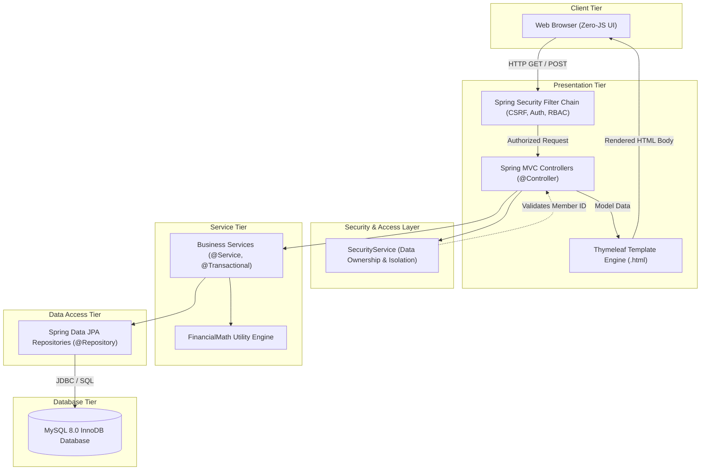

# AMORTIX | PRIME — Comprehensive Engineering & Architectural Master Guide

> **A Complete Developer Reference, Architectural Blueprint, and Interview Preparation Manual**  
> *Target System: Core Cooperative Credit, Lending & Double-Entry Ledger Management Engine*

---

## Table of Contents
1. [Executive Summary & Core Technology Stack](#1-executive-summary--core-technology-stack)
2. [High-Level Architecture & Design Patterns](#2-high-level-architecture--design-patterns)
3. [Double-Entry Accounting & Financial Ledger Principles](#3-double-entry-accounting--financial-ledger-principles)
4. [Master Directory of All Classes & Components](#4-master-directory-of-all-classes--components)
   - [Config & Security Components](#41-configuration--security-components)
   - [Domain Entities & Data Models](#42-domain-entities--data-models)
   - [Repository Layer](#43-spring-data-jpa-repositories)
   - [Business Logic Service Layer](#44-business-logic-service-layer)
   - [Web Presentation Controllers](#45-web-presentation-controllers)
   - [Mathematical & Utility Engines](#46-mathematical--utility-engines)
5. [Complete Catalog of Annotations Used](#5-complete-catalog-of-annotations-used)
   - [Spring Framework & Core Annotations](#51-spring-framework--core-annotations)
   - [Spring MVC & Web Annotations](#52-spring-mvc--web-annotations)
   - [Spring Security 6 Annotations](#53-spring-security-6-annotations)
   - [JPA & Hibernate Persistence Annotations](#54-jpa--hibernate-persistence-annotations)
   - [Testing & Quality Assurance Annotations](#55-testing--quality-assurance-annotations)
6. [Frontend Architecture & Thymeleaf / HTML Dialect](#6-frontend-architecture--thymeleaf--html-dialect)
   - [Thymeleaf Syntax & Expressions](#61-thymeleaf-syntax--standard-expressions)
   - [Spring Security Thymeleaf Dialect](#62-spring-security-thymeleaf-dialect)
   - [Zero-JS Pure CSS Architecture](#63-zero-js-pure-css-architecture)
7. [Comprehensive Git & GitHub Command Guide](#7-comprehensive-git--github-command-guide)
8. [Common Senior Developer Interview Questions on this Project](#8-common-senior-developer-interview-questions-on-this-project)

---

## 1. Executive Summary & Core Technology Stack

**AMORTIX | PRIME** is an enterprise-grade financial management platform designed for Cooperative Credit Societies and Thrift Funds. It automates membership shares, multi-product loan origination and servicing, fixed and recurring deposits, automated monthly payroll recovery schedules, double-entry general ledger balancing, and democratic Annual General Meeting (AGM) voting.

### Core Technology Stack

| Component | Technology | Version | Purpose in Project |
| :--- | :--- | :--- | :--- |
| **Language Runtime** | Java LTS | **Java 21** | Virtual threads readiness, pattern matching, record types, strong type safety. |
| **Application Framework** | Spring Boot | **3.3.1** | Auto-configuration, opinionated dependency management, embedded Tomcat. |
| **Security Engine** | Spring Security | **6.3.1** | Role-Based Access Control (RBAC), password hashing, CSRF protection, data isolation. |
| **ORM / Persistence** | Hibernate / JPA | **6.5.2** | Object-Relational Mapping, automated DDL schema migrations, relational integrity. |
| **Relational Database** | MySQL Server | **8.0** | ACID-compliant persistent transactional storage on Port 3306. |
| **In-Memory Database** | H2 Database | **2.2.224** | Fast, ephemeral in-memory test database for automated integration tests. |
| **Server-Side UI** | Thymeleaf 3 | **3.1.2** | Server-side HTML rendering with zero client-side JavaScript dependencies. |
| **Document Generation** | OpenPDF & Apache POI| **1.3.39 / 5.2.5** | Dynamic loan sanction orders (PDF) and payroll demand sheets (Excel/Text). |
| **Build Automation** | Apache Maven | **3.9+** | Dependency management, compilation, testing, and artifact packaging. |

---

## 2. High-Level Architecture & Design Patterns

The application follows the **Layered Architecture Pattern** combined with **Domain-Driven Design (DDD)** principles and a **Zero-JS Monolithic Deployment Model**.



### Architectural Design Patterns Utilized

1. **Model-View-Controller (MVC)**:
   - **Model**: Domain entities (`Member`, `Loan`, `DepositAccount`, `Voucher`) carrying business state.
   - **View**: Thymeleaf templates (`.html`) rendered strictly on the server.
   - **Controller**: Web controllers orchestrating requests, input validation, and view resolution.

2. **Data Isolation & Defense-in-Depth Security**:
   - Security is enforced at three distinct layers:
     1. **HTTP Layer**: `SecurityConfig` URL pattern matching (`hasRole('ADMIN')`, `hasAnyRole('ADMIN', 'STAFF')`).
     2. **Method Security Layer**: `@PreAuthorize` on controller and service methods.
     3. **Data Ownership Layer**: `SecurityService.validateMemberAccess()` inspecting whether a `MEMBER` is accessing their own records or attempting to access other members' records.

3. **Zero-JS Monolith Pattern**:
   - All interactive UI behaviors (modals, dropdown confirmations, tab navigation) use **Pure CSS3** features such as the `:target` pseudo-class and CSS Flexbox/Grid.
   - Eliminates client-side state desynchronization, NPM dependency vulnerabilities, and client-side credential leakage.

4. **Repository Pattern (Spring Data JPA)**:
   - Decouples domain logic from database access through strongly typed repository interfaces (`JpaRepository<T, ID>`), generating optimized queries automatically.

5. **Constructor-Based Dependency Injection (DI)**:
   - All components use constructor injection instead of `@Autowired` on private fields, guaranteeing immutability (`final` fields) and testability without needing reflection.

---

## 3. Double-Entry Accounting & Financial Ledger Principles

Cooperative credit institutions are legally required to maintain balanced books adhering to standard double-entry bookkeeping. Every monetary movement must have equal **Debit** and **Credit** postings.

### The Fundamental Accounting Equation
$$\text{Assets} = \text{Liabilities} + \text{Equity}$$

### Account Types & Normal Balance Conventions

| Account Category | Normal Balance | Balance Rule | Examples in Project |
| :--- | :---: | :--- | :--- |
| **ASSET** | **DEBIT** | **Debit increases (+)**, Credit decreases (-) | `1001 Cash in Hand`, `1002 Bank Current A/c`, `2001 Loans Outstanding` |
| **LIABILITY** | **CREDIT** | **Credit increases (+)**, Debit decreases (-) | `3001 Thrift Liability`, `3002 Fixed Deposit Liability` |
| **EQUITY** | **CREDIT** | **Credit increases (+)**, Debit decreases (-) | `4001 Paid-Up Share Capital` |
| **INCOME** | **CREDIT** | **Credit increases (+)**, Debit decreases (-) | `5001 Loan Interest Income` |
| **EXPENSE** | **DEBIT** | **Debit increases (+)**, Credit decreases (-) | `6001 Deposit & Thrift Interest Expense`, `6002 Audit & Admin Expense` |

### How Vouchers Update Account Balances in Code

In `AccountingServiceImpl.java`:
```java
// Updating Debit Account:
if ("DEBIT".equalsIgnoreCase(debitAccount.getNormalBalance())) {
    debitAccount.setCurrentBalance(debitAccount.getCurrentBalance().add(voucherAmount)); // Asset/Expense increases
} else {
    debitAccount.setCurrentBalance(debitAccount.getCurrentBalance().subtract(voucherAmount)); // Liability/Income decreases
}

// Updating Credit Account:
if ("CREDIT".equalsIgnoreCase(creditAccount.getNormalBalance())) {
    creditAccount.setCurrentBalance(creditAccount.getCurrentBalance().add(voucherAmount)); // Liability/Income increases
} else {
    creditAccount.setCurrentBalance(creditAccount.getCurrentBalance().subtract(voucherAmount)); // Asset/Expense decreases
}
```

### Day Book Balancing (Daily Accounts Processing)
At the close of every business day:
$$\text{Closing Cash} = \text{Opening Cash} + \text{Cash Receipts} - \text{Cash Disbursements}$$
$$\text{Closing Bank} = \text{Opening Bank} + \text{Bank Receipts} - \text{Bank Disbursements}$$

Once closed, the daybook status is set to `CLOSED`. Any attempt to post a voucher into a closed date throws an `IllegalStateException`.

---

## 4. Master Directory of All Classes & Components

### 4.1. Configuration & Security Components

| Class Name | File Path | Role & Responsibilities | Key Design Decision |
| :--- | :--- | :--- | :--- |
| **`AmortixPrimeApplication`** | `com.amortix.prime` | Spring Boot main entrypoint (`public static void main`). | Bootstraps the application, scans all components and JPA repositories. |
| **`SecurityConfig`** | `com.amortix.prime.config` | Defines the security filter chain, HTTP authorization rules, login form, logout, password encoder, and access-denied routing. | Configures stateless-friendly form login with target URL preservation and custom 403 page redirection. |
| **`UserDetailsServiceImpl`** | `com.amortix.prime.config` | Implements Spring Security's `UserDetailsService`. | Bridges Spring Security's authentication engine with the MySQL `user_accounts` table. |
| **`DataInitializer`** | `com.amortix.prime.config` | Implements `CommandLineRunner`. Seeds initial baseline data. | Pre-populates chart of accounts, master rules, interest tables, and default accounts on clean databases. |

### 4.2. Domain Entities & Data Models (`com.amortix.prime.model`)

| Class Name | Relational Table | Primary Purpose | Key Attributes |
| :--- | :--- | :--- | :--- |
| **`UserAccount`** | `user_accounts` | Operator and member authentication accounts. | `username`, `password` (BCrypt), `roles`, `memberCode`, `enabled`. |
| **`Member`** | `members` | Co-op shareholder master record. | `memberCode`, `employeeCode`, `fullName`, `basicPay`, `shareCapitalBalance`, `thriftBalance`. |
| **`Loan`** | `loans` | Credit facilities (LTL, EXL, ELG, FDL). | `loanAccountNo`, `sanctionAmount`, `interestRate`, `tenureMonths`, `monthlyInstallment`, `outstandingPrincipal`, `sureties`. |
| **`DepositAccount`**| `deposit_accounts` | Fixed (FXD) and Recurring (RCD) accounts. | `depositAccountNo`, `principalAmount`, `tenureMonths`, `maturityAmount`, `accumulatedInterest`, `status`. |
| **`DepositTransaction`** | `deposit_transactions` | Ledger of deposit events (openings, installments, closures). | `depositAccountNo`, `txnType`, `amount`, `balanceAfterTxn`, `receiptNo`. |
| **`LoanTransaction`**| `loan_transactions` | Ledger of loan disbursements and repayments. | `loanAccountNo`, `txnType`, `principalAmount`, `interestAmount`, `totalAmount`, `receiptNo`. |
| **`ThriftTransaction`**| `thrift_transactions` | Compulsory monthly savings ledger. | `memberCode`, `txnType`, `amount`, `balanceAfterTxn`, `recoveryRunId`. |
| **`GeneralLedgerAccount`**| `ledger_accounts` | General ledger chart of accounts. | `accountCode`, `accountName`, `accountType` (ASSET, LIABILITY, etc.), `normalBalance`, `currentBalance`. |
| **`DailyAccountProcessing`**| `daily_accounts_processing` | Daily cashier and bank balance record (Day Book). | `processingDate`, `openingCashBalance`, `closingCashBalance`, `dayStatus` (`OPEN` / `CLOSED`). |
| **`Voucher`** | `vouchers` | Double-entry journal voucher document. | `voucherNo`, `voucherType` (`RECEIPT`, `PAYMENT`, `JV`), `debitAccountCode`, `creditAccountCode`, `amount`. |
| **`MonthlyRecoveryRun`**| `monthly_recovery_runs` | Payroll deduction billing cycle. | `runCode`, `month`, `year`, `totalGrossDemand`, `totalActualRecovered`, `status` (`DEMAND_GENERATED`, `RECONCILED`). |
| **`SuretyReplacement`** | `surety_replacements` | Request workflow to substitute a guarantor. | `loanAccountNo`, `oldSuretyMemberCode`, `newSuretyMemberCode`, `status` (`PENDING`, `APPROVED`). |
| **`SocietyRule`** | `society_rules` | Configurable society bylaws. | `ruleCode` (`MAX_LOAN_MULTIPLIER`, `MIN_SERVICE_MONTHS`), `ruleValue`. |
| **`InterestRateRule`**| `interest_rate_rules` | Product interest rates. | `productCode`, `interestRate`, `calculationMethod` (`REDUCING_BALANCE`, `COMPOUND_QUARTERLY`). |
| **`Poll`** | `society_polls` | Democratic AGM resolutions. | `title`, `description`, `options`, `voteCounts`, `memberVotes`. |
| **`AuditLog`** | `audit_logs` | Immutable security audit trail. | `username`, `action`, `entityName`, `entityId`, `details`, `timestamp`. |

### 4.3. Spring Data JPA Repositories (`com.amortix.prime.repository`)

Every entity has a matching Spring Data interface inheriting `JpaRepository<T, String>`:
- `UserAccountRepository`, `MemberRepository`, `LoanRepository`, `DepositAccountRepository`, `DepositTransactionRepository`, `LoanTransactionRepository`, `ThriftTransactionRepository`, `GeneralLedgerAccountRepository`, `DailyAccountProcessingRepository`, `VoucherRepository`, `MonthlyRecoveryRunRepository`, `SuretyReplacementRepository`, `SocietyRuleRepository`, `InterestRateRuleRepository`, `PollRepository`, `AuditLogRepository`.

### 4.4. Business Logic Service Layer (`com.amortix.prime.service.impl`)

1. **`SecurityServiceImpl`**:
   - Resolves the authenticated user's authorities and linked member code.
   - Throws `AccessDeniedException` if a `ROLE_MEMBER` tries to inspect or modify another member's profile, loans, deposits, or thrift records.

2. **`MemberServiceImpl`**:
   - Manages member enrollment, address/nominee tracking, share allotments.
   - Executes full and final settlements with validation: blocks liquidation if outstanding loans exceed accumulated savings (`netPayable < 0`).

3. **`LoanServiceImpl`**:
   - Validates service period bylaws (`MIN_SERVICE_MONTHS`) and salary multiplier limits (`MAX_LOAN_MULTIPLIER`).
   - Prevents self-guarantees and duplicate sureties.
   - Enforces strict lifecycle state transitions (`APPLIED` $\rightarrow$ `APPROVED` $\rightarrow$ `ACTIVE` $\rightarrow$ `CLOSED`).
   - Posts disbursement and repayment vouchers to the double-entry general ledger.

4. **`DepositServiceImpl`**:
   - Calculates compound maturity values for Fixed Deposits (FXD) and Recurring Cumulative Deposits (RCD).
   - Computes premature withdrawals based on **actual elapsed months** and applies the regulatory penalty (`FXP` rule).

5. **`ThriftServiceImpl`**:
   - Accumulates compulsory monthly member thrift contributions.
   - Calculates and credits annual compound interest, posting society interest expense to liability vouchers (`6001` $\rightarrow$ `3001`).

6. **`MonthlyRecoveryServiceImpl`**:
   - Generates society-wide payroll demand schedules aggregating thrift, multi-loan EMIs, and recurring deposits across all active members.
   - Reconciles payroll response files (UTF-8) with waterfall allocation: Thrift $\rightarrow$ RCD $\rightarrow$ Loan Interest $\rightarrow$ Loan Principal.
   - Generates unique transaction receipt numbers per member (`REC-{runCode}-{memberCode}`).
   - Prevents duplicate reconciliation runs.

7. **`AccountingServiceImpl`**:
   - Manages the chart of accounts, double-entry vouchers, day book opening/closing, and real-time trial balance balancing.
   - Enforces the Day-End lock: blocks voucher entry on closed accounting days.

8. **`PdfExportService`**:
   - Generates printable, high-resolution PDF loan sanction orders using OpenPDF.

### 4.5. Web Presentation Controllers (`com.amortix.prime.controller`)

- **`AuthController`**: Handles `/login`, `/logout`, `/access-denied`.
- **`DashboardController`**: Routes users to either the **Executive Cockpit** (for `ADMIN` and `STAFF`) or the **Member Personal Cockpit** (for `MEMBER`).
- **`MemberController`**: Routes for `/members`, `/members/new`, `/members/view/{code}`, `/members/settle/{code}`, `/members/my-profile`.
- **`LoanController`**: Routes for `/loans`, `/loans/apply`, `/loans/view/{accNo}`, `/loans/approve/{accNo}`, `/loans/disburse/{accNo}`, `/loans/repay/{accNo}`, `/loans/pdf/{accNo}`.
- **`DepositController`**: Routes for `/deposits`, `/deposits/open`, `/deposits/view/{depNo}`, `/deposits/premature-close/{depNo}`, `/deposits/rcd-installment`.
- **`ThriftController`**: Routes for `/thrift`, `/thrift/member/{code}`, `/thrift/annual-interest`, `/thrift/my-thrift`.
- **`RecoveryController`**: Routes for `/recovery`, `/recovery/generate`, `/recovery/view/{code}`, `/recovery/export/{code}`, `/recovery/reconcile/{code}`.
- **`AccountingController`**: Routes for `/accounting/daybook`, `/accounting/daybook/close`, `/accounting/vouchers`, `/accounting/voucher/new`, `/accounting/trial-balance`.
- **`AdminController`**: Routes for `/admin/rules`, `/admin/interest-rates`, `/admin/users`, `/admin/audit-logs`.
- **`PollController`**: Routes for democratic voting `/polls`, `/polls/vote`, and resolution creation `/polls/create`.

### 4.6. Mathematical & Utility Engines (`com.amortix.prime.util`)

- **`FinancialMath`**:
  - Implements financial algorithms using exact `BigDecimal` arithmetic with `RoundingMode.HALF_UP`.
  - **Reducing Balance EMI**:
    $$\text{EMI} = \frac{P \times r \times (1 + r)^n}{(1 + r)^n - 1}$$
    where $P = \text{Principal}$, $r = \frac{\text{Annual Rate}}{12 \times 100}$, $n = \text{Tenure Months}$.
  - **Quarterly Compounded Fixed Deposit Maturity**:
    $$A = P \times \left(1 + \frac{r}{4}\right)^{4 \times t}$$
  - **Recurring Deposit Maturity** using cumulative quarterly compound summation.

---

## 5. Complete Catalog of Annotations Used

### 5.1. Spring Framework & Core Annotations

| Annotation | Where Used | Why We Used It | Advantages |
| :--- | :--- | :--- | :--- |
| **`@SpringBootApplication`** | `AmortixPrimeApplication` | Bootstraps the application. Encompasses `@Configuration`, `@EnableAutoConfiguration`, and `@ComponentScan`. | Eliminates XML configuration; enables auto-configuration of embedded Tomcat, DataSource, and JPA. |
| **`@Configuration`** | `SecurityConfig` | Marks a class as a source of Spring bean definitions (`@Bean`). | Allows programmatically customizing security filters, encoders, and managers. |
| **`@Bean`** | `SecurityConfig` methods | Declares a factory method that Spring IoC container calls to register a managed bean. | Produces singleton beans like `PasswordEncoder`, `SecurityFilterChain`, and `AuthenticationManager`. |
| **`@Component`** | `DataInitializer` | Marks a class as a general-purpose Spring-managed singleton bean. | Spring auto-detects this bean during classpath scanning and executes its `CommandLineRunner.run()`. |
| **`@Service`** | All Service Implementations (`*ServiceImpl`) | Specialization of `@Component` indicating a domain service layer component. | Clarifies architectural intent; enables Spring AOP proxying and transactional management. |
| **`@Repository`** | All 16 Repository interfaces | Specialization of `@Component` indicating a Data Access Object (DAO). | Translates database-specific SQL exceptions into Spring's consistent `DataAccessException` hierarchy. |
| **`@Transactional`** | Service methods mutating state | Defines database transaction boundaries on methods. | Automatically starts a transaction; executes `commit` on success and `rollback` on uncaught `RuntimeException`. |

### 5.2. Spring MVC & Web Annotations

| Annotation | Where Used | Why We Used It | Advantages |
| :--- | :--- | :--- | :--- |
| **`@Controller`** | All Controllers | Declares a Spring MVC web controller returning view names (Thymeleaf templates). | Integrates with Thymeleaf to pass model data and render server-side HTML. |
| **`@RequestMapping`** | Class level on Controllers | Defines the base URL prefix for all handler methods in the controller (e.g. `/loans`, `/members`). | Centralizes URL namespace hierarchy, reducing redundancy. |
| **`@GetMapping`** | Read-only methods | Maps HTTP `GET` requests to specific controller methods. | Semantic clarity; guarantees idempotent read operations (e.g. `/loans/view/{accNo}`). |
| **`@PostMapping`** | Mutation methods | Maps HTTP `POST` requests to specific controller methods. | Ensures state-altering operations (save, approve, disburse, repay) require POST requests protected by CSRF tokens. |
| **`@RequestParam`** | Controller method arguments | Binds query parameters (`?date=2026-10-31`) or form body inputs to method variables. | Provides type conversion, default values (`defaultValue = "0"`), and null-checks (`required = false`). |
| **`@PathVariable`** | Controller method arguments | Extracts dynamic URI template variables (e.g. `/members/view/{memberCode}`). | Enables clean RESTful URL paths. |
| **`@ModelAttribute`** | Form binding parameters | Binds incoming HTML form data directly to a Java domain entity (e.g. `@ModelAttribute Loan loan`). | Automates parameter population, reducing manual parsing code. |
| **`@DateTimeFormat`** | Date parameters | Specifies date parsing formats (e.g. `@DateTimeFormat(iso = DateTimeFormat.ISO.DATE)`). | Prevents date parsing errors from HTML5 `<input type="date">` (`YYYY-MM-DD`). |

### 5.3. Spring Security 6 Annotations

| Annotation | Where Used | Why We Used It | Advantages |
| :--- | :--- | :--- | :--- |
| **`@EnableWebSecurity`** | `SecurityConfig` | Enables Spring Security’s web security support and filter chain integration. | Replaces default authentication configurations with custom security filters. |
| **`@EnableMethodSecurity`** | `SecurityConfig` | Activates method-level authorization (such as `@PreAuthorize`). | Enables fine-grained authorization directly on controller methods and services. |
| **`@PreAuthorize`** | Controller methods & classes | Evaluates SpEL expressions before method execution (e.g. `@PreAuthorize("hasRole('ADMIN')")`). | Denies unauthorized execution before business code runs; acts as defense-in-depth even if URL filters fail. |

### 5.4. JPA & Hibernate Persistence Annotations

| Annotation | Where Used | Why We Used It | Advantages |
| :--- | :--- | :--- | :--- |
| **`@Entity`** | All Model classes | Marks a Java class as a persistent relational database entity. | Hibernate manages its lifecycle, tracking changes and writing them to MySQL. |
| **`@Table`** | Entity class level | Specifies the exact relational table name in MySQL (e.g. `@Table(name = "user_accounts")`). | Decouples Java class names from SQL table naming conventions. |
| **`@Id`** | Primary key fields | Declares the primary key of the entity. | Uniquely identifies rows for Hibernate entity caching and persistence. |
| **`@GeneratedValue`** | ID fields | Configures primary key generation strategy (`strategy = GenerationType.UUID`). | Generates collision-resistant unique UUID strings across distributed instances. |
| **`@Column`** | Field level | Customizes table column parameters (`unique = true`, `nullable = false`, `length = 2000`). | Enforces database constraints and renames reserved words (e.g. `@Column(name = "billing_month")`). |
| **`@ElementCollection`** | List / Map attributes | Maps non-entity collections (like list of addresses or nominee embedded objects). | Stores collections in separate child tables without requiring standalone entity IDs. |
| **`@CollectionTable`** | Collection fields | Defines the foreign key join column and child table name for `@ElementCollection`. | Keeps database schemas normalized and relational. |
| **`@MapKeyColumn`** | Map collections | Defines the column storing the map key in a collection table (e.g. `@MapKeyColumn(name = "member_code")`). | Maps dictionary-like structures directly into relational tables (used in `Poll.memberVotes`). |

### 5.5. Testing & Quality Assurance Annotations

| Annotation | Where Used | Why We Used It | Advantages |
| :--- | :--- | :--- | :--- |
| **`@SpringBootTest`** | Test classes | Boots the full Spring ApplicationContext for comprehensive integration testing. | Injects real service, repository, and security beans into the test environment. |
| **`@AutoConfigureMockMvc`** | Test classes | Configures `MockMvc` instance for sending simulated HTTP requests. | Tests web endpoints, security filters, CSRF tokens, and HTTP status codes without starting an actual network server. |
| **`@ActiveProfiles("test")`**| Test classes | Activates the `test` Spring profile (`application-test.yml`). | Switches datasource to in-memory H2 database, keeping production MySQL untouched during automated runs. |
| **`@WithMockUser`** | Test methods | Injects a pre-authenticated mock security user with specific roles (`roles = {"MEMBER"}`). | Verifies role boundaries (`ADMIN`, `STAFF`, `MEMBER`) without manual login forms. |
| **`@Test`** | Test methods | Declares a method as a runnable JUnit 5 test case. | Recognized by Maven Surefire runner during `mvn test`. |
| **`@DisplayName`** | Test methods | Provides human-readable descriptions for test scenarios. | Produces clean, informative reports in test logs and CI/CD pipelines. |

---

## 6. Frontend Architecture & Thymeleaf / HTML Dialect

### 6.1. Thymeleaf Syntax & Standard Expressions

Thymeleaf is a modern server-side Java template engine that processes standard HTML5 templates directly.

| Thymeleaf Expression | Syntax Example | Meaning & Behavior |
| :--- | :--- | :--- |
| **Variable Expression** | `${member.fullName}` | Evaluates an attribute passed by the controller in the Spring `Model`. |
| **Link URL Expression** | `@{/loans/view/{id}(id=${l.loanAccountNo})}` | Context-aware URL resolver; prefixes application context path automatically. |
| **Message / Text Expression**| `th:text="'₹' + ${amount}"` | Replaces the inner text of an HTML tag with the evaluated value, escaping HTML. |
| **Attribute Replacement** | `th:value="${search}"` | Replaces an HTML attribute (e.g. form input `value`). |
| **Conditional Rendering** | `th:if="${member.status == 'ACTIVE'}"` | Renders the HTML element only if the condition evaluates to `true`. |
| **Iterative Rendering** | `th:each="l : ${loans}"` | Iterates over a collection, repeating the HTML element for each item. |
| **Fragment Inlining** | `th:replace="~{fragments/layout :: main(...)}"` | Injects page content into a master layout template, eliminating redundant boilerplate. |

### 6.2. Spring Security Thymeleaf Dialect

By including `thymeleaf-extras-springsecurity6`, Thymeleaf templates dynamically adapt their navigation and action buttons based on the user's role:

#### 1. Conditional UI Rendering Based on Role:
```html
<!-- Visible ONLY to System Administrators -->
<li sec:authorize="hasRole('ADMIN')">
    <a class="nav-link" th:href="@{/admin/users}">👥 Staff & User RBAC</a>
</li>

<!-- Visible to Operational Staff and Administrators -->
<th:block sec:authorize="hasAnyRole('ADMIN', 'STAFF')">
    <li><a class="nav-link" th:href="@{/members}">👥 Member Portfolio</a></li>
</th:block>

<!-- Visible ONLY to Pure Members -->
<th:block sec:authorize="hasRole('MEMBER') and !hasAnyRole('ADMIN', 'STAFF')">
    <li><a class="nav-link" th:href="@{/dashboard}">📊 My Dashboard</a></li>
    <li><a class="nav-link" th:href="@{/members/my-profile}">👤 My 360° Profile</a></li>
</th:block>
```

#### 2. Displaying Authenticated User Data:
```html
<strong sec:authentication="name">admin</strong>
```

### 6.3. Zero-JS Pure CSS Architecture

To ensure strict zero-JS compliance, modal windows (such as *Loan Approval*, *Disbursement*, *Premature Close*, *Day Book Closing*, and *New Resolution*) use CSS3 `:target` routing:

```html
<!-- Modal Trigger (Normal Link) -->
<a href="#approveModal" class="btn btn-primary btn-sm">Approve Loan</a>

<!-- Modal Overlay (Pure CSS) -->
<div id="approveModal" class="modal-overlay">
    <div class="modal-box">
        <a href="#" class="modal-close">&times;</a>
        <h3>Approve Loan Application</h3>
        <form th:action="@{'/loans/approve/' + ${loan.loanAccountNo}}" method="post">
            <button type="submit" class="btn btn-primary">Confirm Approval</button>
        </form>
    </div>
</div>
```

**Underlying CSS (`amortix-theme.css`):**
```css
.modal-overlay {
    display: none;
    position: fixed;
    top: 0; left: 0; width: 100%; height: 100%;
    background: rgba(0, 0, 0, 0.75);
    backdrop-filter: blur(4px);
}
.modal-overlay:target {
    display: flex; /* Activates modal when URL hash matches #approveModal */
    align-items: center;
    justify-content: center;
}
```

---

## 7. Comprehensive Git & GitHub Command Guide

Here are the commands used in this project's version control workflow:

### 1. Repository Setup & Inspection
```bash
# Check the current status of files (modified, untracked, staged)
git status

# Inspect commit history with one-line graph view
git log --oneline --graph --decorate
```

### 2. Branching & Isolation
```bash
# Create and immediately switch to a dedicated audit/feature branch
git checkout -b audit-rbac-bugfixes

# List all local branches (the active branch is marked with an asterisk *)
git branch

# Switch back to the main branch
git checkout main
```

### 3. Staging & Committing Code
```bash
# Stage all changes (new files, edits, deletions)
git add -A

# Commit staged changes with an industry-standard Conventional Commits message
git commit -m "feat(security): complete rbac audit, data isolation, financial bugfixes and automated tests"
```

### 4. Remote Synchronization & Pushing
```bash
# Verify configured remote GitHub repository URL
git remote -v

# Push the new feature/audit branch to remote GitHub repository and track it
git push -u origin audit-rbac-bugfixes

# Pull latest commits from GitHub main branch
git pull origin main
```

---

## 8. Common Senior Developer Interview Questions on this Project

### Q1: Why did you use constructor-based dependency injection instead of `@Autowired` on fields?
> **Answer:**  
> Field injection (`@Autowired private LoanRepository loanRepo;`) hides class dependencies, makes unit testing difficult without starting a Spring container or using reflection, and prevents fields from being declared `final`. Constructor injection enforces that all required dependencies must be provided at instantiation time, guarantees immutability, and makes pure Mockito unit tests straightforward without needing `@InjectMocks`.

### Q2: How does Amortix-Prime enforce Member Data Isolation, and why is URL protection alone not enough?
> **Answer:**  
> URL path protection (`/members/**` hasRole `STAFF`) only verifies role membership, not record ownership. An ordinary member with valid access to `/loans/view/{id}` could alter the URL to `/loans/view/LTL-10002` to inspect another colleague's loan.  
> We implemented defense-in-depth:
> 1. `SecurityConfig` restricts administrative URL paths.
> 2. `SecurityService` checks the authenticated username's linked `memberCode` against the requested loan/deposit/member record. If they do not match and the user is not an `ADMIN` or `STAFF`, an `AccessDeniedException` (HTTP 403) is thrown immediately.

### Q3: Why is `double` or `float` prohibited for financial arithmetic, and how does `BigDecimal` prevent rounding errors?
> **Answer:**  
> Binary floating-point numbers (`double`/`float`) cannot accurately represent decimal fractions like `0.1` or `0.05` due to base-2 IEEE 754 precision limits (e.g., `1.0 - 0.9` yields `0.09999999999999998`). In banking and lending systems, these discrepancies cause ledger imbalances.  
> We use `BigDecimal` with explicit scale and `RoundingMode.HALF_UP`, ensuring exact decimal calculations that comply with statutory accounting audits.

### Q4: How does Spring Security 6 configure security compared to older Spring Security 5?
> **Answer:**  
> Spring Security 6 deprecated `WebSecurityConfigurerAdapter` and fluid chained builders in favor of the **Component-Based Configuration model** using `SecurityFilterChain` beans and the **Lambda DSL**:
> ```java
> http.authorizeHttpRequests(auth -> auth
>     .requestMatchers("/admin/**").hasRole("ADMIN")
>     .anyRequest().authenticated()
> )
> .formLogin(Customizer.withDefaults());
> ```
> This eliminates shared mutable state and makes configuration explicit.

### Q5: How does the system handle concurrent transactions and prevent double-disbursement of loans?
> **Answer:**  
> Loan disbursement methods are annotated with `@Transactional`. Before disbursement occurs, the loan's status is validated:
> ```java
> if (!"APPROVED".equalsIgnoreCase(loan.getStatus())) {
>     throw new IllegalStateException("Loan must be APPROVED first.");
> }
> loan.setStatus("ACTIVE");
> ```
> Under MySQL InnoDB's transactional isolation, row-level locks prevent concurrent threads from executing duplicate disbursements simultaneously.

---

### Project Reference Summary
- **Source Code Path:** `C:\Users\Asus\Projects\Amortix-Prime`
- **Active Git Branch:** `audit-rbac-bugfixes`
- **Remote GitHub Repository:** `https://github.com/Sureekutty/Amortix-Prime.git`
- **Test Suite Status:** 41 / 41 Tests Passing (0 Failures, 0 Errors)
